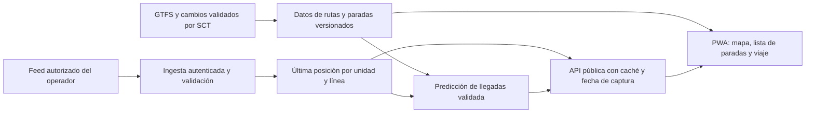

# MetroRed Huasteca: viabilidad, datos y herramientas

Investigación pública: **28 de octubre de 2026**. Alcance: Ciudad Valles urbano y conexión regional Riviera Huasteca. Este documento prepara la decisión de desarrollo; no acredita un acceso concedido ni una integración funcionando.

**La app es técnicamente viable. Podemos preparar una guía fiable de rutas y paradas, y después incorporar seguimiento real. La dependencia principal es conseguir datos operativos vigentes y una fuente autorizada de posiciones de las unidades.** No localicé un GTFS, GTFS Realtime o API pública de Valles listo para consumir en las fuentes revisadas. Eso no demuestra que los datos no existan internamente.

## 1. Qué está confirmado

| Servicio o infraestructura | Evidencia | Alcance de la confirmación |
| --- | --- | --- |
| Inicio urbano de Valles | [SSPC, 12-09-2025](https://seguridad.slp.gob.mx/noticias/2025/9/12/con-red-metro-en-la-huasteca-seguridad-y-movilidad-sin-l%C3%ADmites-jes%C3%BAs-ju%C3%A1rez-hern%C3%A1ndez/) | Confirma inicio el 11 de septiembre e inauguración del Centro de Monitoreo, con función declarada de supervisión en tiempo real y comunicación. No prueba su funcionamiento actual ni publica coordenadas GPS, proveedor o API. |
| L1 y L2 urbanas | [Gobierno estatal](https://slp.gob.mx/noticias/2026/3/11/redmetro-de-valles-supera-12-millones-de-viajes-y-m%C3%A1s-apoyo-a-las-familias-ricardo-gallardo/) | El cuerpo está fechado 14-02-2026, aunque la URL diga marzo. Identifica la L1 Universitaria y la L2, con destinos como Tec, IMSS, Centro, UASLP, ISSSTE y Cobach 24. No es un inventario georreferenciado vigente. |
| **L3 urbana inaugurada el 26-10-2026** | [Gobierno estatal / Turismo](https://slp.gob.mx/noticias/2026/10/26/inauguraci%C3%B3n-de-la-l%C3%ADnea-3-de-la-red-metro/) | Confirma inauguración y puesta en marcha. No contiene catálogo de paradas, sentidos, trazo ni horario. Por tanto, la descripción de “dos líneas” de febrero quedó incompleta. |
| Riviera Huasteca, Valles–Tamazunchale | [Turismo, 14-09-2026](https://slp.gob.mx/noticias/2026/9/14/arranque-de-la-nueva-ruta-de-la-red-metro-riviera-huasteca/) y [INDEPI, 17-09-2026](https://indepi.slp.gob.mx/noticias/2026/9/17/gobierno-estatal-fortalece-movilidad-regional-con-nueva-conexi%C3%B3n-entre-ciudad-valles-y-tamazunchale/) | Es una conexión regional distinta de las líneas urbanas. Conectar municipios no implica entrar a todas las cabeceras, hoteles o parajes. |

Hay un cambio que obliga a validar el trazo actual de L3: [Código San Luis, 26-10-2026](https://codigosanluis.com/nueva-ruta-metrored-conecta-70-colonias-valles/) reporta operación provisional por obras, 16 paradores y frecuencia de 10–15 minutos. Es información periodística atribuida a SCT; esos detalles no quedaron corroborados en la publicación gubernamental encontrada. **No los usaría aún para publicar coordenadas o prometer una llegada.** El anuncio oficial de paradores de [febrero de 2025](https://slp.gob.mx/noticias/2025/2/7/ricardo-gallardo-define-las-nuevas-rutas-de-metrored-en-valles-y-rioverde/) también antecede a la apertura y requiere actualización.

## 2. Qué existe para el pasajero y qué falta comprobar

La premisa de que no hay ninguna aplicación requiere acotarse a **Valles y seguimiento comprobado de vehículos**:

- [SCT](https://sct.slp.gob.mx/) enlaza la web [Mi RedMetro](https://miredmetro.sctslp.com/). Su contenido público L1–L4 y el mapa “Eje 128” de L1 corresponden a la capital; sus horarios no se pueden trasladar a Valles.
- [RedMetro Ciudad Valles](https://redmetrovalles.sctslp.com/) ofrece registro y QR de acceso. Su portada no presenta un feed de posiciones. El padrón de usuarios no es una fuente de movilidad que necesitemos consumir.
- [Moovit sí publica MetroRed](https://moovitapp.com/index/es-419/transporte_p%C3%BAblico-lines-San_Luis_Potos%C3%AD-3742-3756032): la ficha revisada enumera cuatro líneas de la zona metropolitana de la capital. Sus textos sobre tiempo real no acreditan GPS disponible en Valles. No se validó una unidad de Valles moviéndose en esa app.
- Google Maps puede incorporar transporte cuando recibe datos de las agencias. No se realizó una consulta facturable que comprobara cobertura operativa de Valles. La existencia de un lugar, una carretera o un mapa de SLP no demuestra esa cobertura.

La conclusión de esta revisión es **“no se confirmó una solución pública con GPS de MetroRed Valles”**. No es una certificación de inexistencia de aplicaciones, proyectos o convenios.

## 3. Matriz de datos necesarios

| Dato | Situación encontrada | Fuente que necesitamos | Qué permite |
| --- | --- | --- | --- |
| Identidad de líneas y destinos principales | Documentación oficial parcial | SCT / operación RedMetro | Selector de líneas y orientación inicial. |
| Trazo por sentido y variantes, incluida L3 provisional | No se localizó archivo operativo vigente | SCT: GTFS, GeoJSON, KML o GIS validado | Dibujar el recorrido real, no la ruta más corta que calcularía un navegador. |
| Paradas: ID, nombre, coordenadas, orden, sentido y accesibilidad | Listas documentales previas; no catálogo completo verificado | SCT y comprobación de campo coordinada | Parada cercana, secuencia de viaje y transbordos. |
| Días, calendario, primer/último servicio y frecuencias | No se obtuvo horario de Valles validado y estructurado | Programación operativa SCT | Mostrar servicio programado. Una frecuencia no es una hora exacta de llegada. |
| Posición de cada unidad y hora de captura | Centro inaugurado y supervisión declarada; operación actual y coordenadas exportables no verificadas | Responsable del sistema de localización que SCT identifique | Ubicación observada del autobús. |
| Unidad asignada a línea, sentido y viaje | No hallada públicamente | Despacho / sistema del operador | Evitar confundir unidades fuera de servicio, retornos o ramales. |
| Llegadas previstas y cancelaciones | No halladas públicamente | GTFS-RT TripUpdates/Alerts o cálculo propio validado | ETA y avisos con una base comprobable. |
| Licencia y permiso de redistribución | No se localizó licencia de feed local | Titular de datos identificado por SCT | Publicar, almacenar y servir datos con condiciones claras. |
| Calles, localidades, establecimientos y contexto | Hay fuentes abiertas complementarias | INEGI y OSM | Búsqueda de destinos, mapa y caminata. No aportan GPS de la flota. |

Preferencia de intercambio: [GTFS Schedule](https://gtfs.org/documentation/schedule/reference/) para rutas/paradas/servicios; [GTFS Realtime](https://gtfs.org/documentation/realtime/reference/) para posiciones, predicciones y alertas. Que el formato sea abierto no convierte automáticamente el contenido de cualquier proveedor en datos de libre reutilización.

**Catálogos revisados:** el [CSV público de MobilityData](https://files.mobilitydatabase.org/feeds_v2.csv), con modificación indicada del 20-10-2026, tenía 6,686 filas: 13 de México, todas GTFS estático, sin coincidencias de San Luis Potosí, Ciudad Valles, MetroRed/RedMetro o Huasteca. El [Hub de Codeando México](https://hdtp.codeandomexico.org/datos), contrastado con su [DCAT JSON](https://hdtp.codeandomexico.org/datos/catalogo.json), tenía 21 conjuntos sin esas coincidencias. También se buscaron referencias en los portales SCT, SLP y datos.gob.mx. Son búsquedas acotadas, no un censo exhaustivo de sistemas internos. Los metadatos del catálogo no sustituyen la licencia de cada feed.

## 4. Quién puede facilitar los datos

| Institución o empresa | Papel comprobado o posible | Ruta concreta de acceso |
| --- | --- | --- |
| **SCTSLP / área operativa RedMetro** | Fuente institucional principal para confirmar rutas, programación, responsables y convenios. El portal QR identifica a SCT como responsable de ese sistema. | Solicitar datos operativos vigentes, titularidad, proveedor de monitoreo y posibilidad de integración pública. No se identificó con certeza una empresa GPS ni un OPD aplicable a Valles. |
| Centro de Monitoreo de Valles | Inauguración y función de supervisión declaradas por SSPC; funcionamiento actual no verificado. | SCT debe indicar qué información produce actualmente, quién la administra y qué puede exportar. Tener pantallas o comunicación no prueba que exista una API de coordenadas. |
| Unidad de Transparencia SCT | Canal institucional para obtener documentos o archivos existentes e identificar contratos/responsables. | Usar los canales publicados por SCT y su enlace a la Plataforma Nacional de Transparencia. Una respuesta documental no equivale a un convenio técnico ni a la creación de un servicio en vivo. |
| Ayuntamiento / responsables de infraestructura | Posible apoyo para validar paradores y accesos peatonales. No se acreditó custodia de GPS. | Coordinar inventario de campo y actualización de infraestructura después de identificar el área competente. |
| **INEGI** | Gobierno federal: cartografía y establecimientos. | [Red Nacional de Caminos](https://www.inegi.org.mx/programas/rnc/) y [API DENUE](https://www.inegi.org.mx/servicios/api-denue/), que requiere token. Aplicar [términos de libre uso y créditos](https://www.inegi.org.mx/contenidos/inegi/doc/terminos_info.pdf). |
| Google Maps Platform | Mapas, búsquedas y planificación de transporte donde haya cobertura. | [Routes Transit](https://developers.google.com/maps/documentation/routes/transit-route) puede devolver paradas y horarios. [Google Transit](https://developers.google.com/transit) recibe feeds de agencias; no concede por ello acceso al GPS bruto de todas las unidades. |
| Moovit | Agregador y proveedor comercial de APIs de transporte. | [Transit APIs](https://moovit.com/maas-solutions/transit-apis/) ofrece servicios medidos por volumen. Habría que confirmar Valles, derechos y precio con el proveedor; no se encontró un feed gratuito de Valles para nuestra app. |

Canales publicados por [SCT](https://sct.slp.gob.mx/): **444 812 0677** y **atencionciudadana.sctslp@gmail.com**. El aviso de [RedMetro Valles](https://redmetrovalles.sctslp.com/) publica la Unidad de Transparencia, extensión 116 y **sct.transparencia23@gmail.com**. Son contactos institucionales publicados, no mensajes enviados. Preparé [dos borradores separados](SOLICITUD-DATOS.md): información documental y colaboración técnica.

## 5. Opciones gratuitas: recomendación y límites

**Recomiendo una PWA con React/TypeScript y MapLibre GL JS, un mapa base con condiciones claras, datos locales versionados y un único backend cuando tengamos la fuente operativa.** MapLibre permite una vista de mapa con inclinación y capas personalizadas; Three.js puede reservarse para experiencias opcionales. En movilidad, el mapa, las próximas llegadas y el estado de los datos deben abrir con rapidez en teléfonos modestos.

| Componente | Aporte | Condiciones y elección |
| --- | --- | --- |
| [MapLibre GL JS](https://maplibre.org/maplibre-gl-js/docs/) | Visor libre BSD-3-Clause, rutas, paradas, vehículos y vista inclinada. | Recomendado. Es el motor de visualización; necesita datos y mapa base. |
| [OpenFreeMap](https://openfreemap.org/) | Mapa base OSM alojado, sin cuenta ni clave, uso comercial y sin límite declarado de solicitudes/vistas. | Candidato para piloto. Atribución obligatoria; sin SLA y sujeto a cambios. Sus [términos del 14-10-2026](https://openfreemap.org/tos/) acotan descargas offline a 3,000 tiles o 50 MB, máximo cuatro peticiones paralelas y User-Agent identificable. Verificar cómo cumplirlo en el cliente elegido antes de ofrecer esa descarga. |
| [OpenStreetMap](https://www.openstreetmap.org/copyright/en) | Calles y puntos bajo ODbL. | Atribución y obligaciones de bases derivadas. No certifica servicio de autobuses. Los [tiles públicos OSMF](https://operations.osmfoundation.org/policies/tiles/) no son alojamiento ilimitado ni permiten precarga offline. |
| [INEGI](https://www.inegi.org.mx/servicios/api-denue/) | Destinos y establecimientos, con coordenadas y metadatos oficiales. | Preparar sólo el recorte necesario. La red vial no incluye movimiento ni horario de MetroRed. |
| [Cloudflare Workers Static Assets](https://developers.cloudflare.com/workers/static-assets/billing-and-limitations/) | Publicar los archivos de la PWA. | Solicitudes a estáticos gratuitas e ilimitadas según su documentación; API y otros servicios tienen límites diferentes. No exige cambiar ahora la publicación existente. |
| [Supabase Free](https://supabase.com/pricing) | Alternativa preferente de backend para un piloto que necesite Postgres/PostGIS, edición controlada y tiempo real. | 500 MB de base, 1 GB de archivos, 5 GB de egreso, dos proyectos activos; pausa tras una semana inactiva. [Realtime Free](https://supabase.com/docs/guides/realtime/limits): 200 conexiones simultáneas; franquicia de 2 millones de mensajes/mes. La difusión [cuenta por destinatario](https://supabase.com/docs/guides/platform/manage-your-usage/realtime-messages). No es capacidad gratuita ilimitada. |
| [Workers Free](https://developers.cloudflare.com/workers/platform/limits/) | Alternativa para una API pequeña con caché y difusión planificada. | 100,000 solicitudes/día, 10 ms CPU, 128 MB. Persistencia, conexiones y programación requieren diseñar y medir servicios adicionales. No sumar dos backends por defecto. |
| [OpenTripPlanner](https://docs.opentripplanner.org/en/latest/) | Planificación multimodal con GTFS y OSM. | Software libre, pero necesita servidor/memoria y datos válidos. Posponer hasta que la red y los transbordos lo justifiquen; no cabe por defecto en un Worker gratuito. |
| [Valhalla](https://github.com/valhalla/valhalla) | Caminata y ajuste de trazas a la red vial. | Código MIT; operar el servicio cuesta recursos. Su demostración pública no es un backend de producción garantizado. |
| [Traccar](https://www.traccar.org/api-reference) | Alternativa de captura de posiciones si el operador autoriza un piloto propio. | Código Apache-2.0. Necesita dispositivo o cliente por unidad, conectividad y servidor. Sus [servidores demo](https://www.traccar.org/demo-server/) no garantizan producción. No hace aparecer datos de flota ajena. |

Ejemplo de capacidad, **no medición de usuarios reales**: 100 personas consultando cada 30 segundos durante cuatro horas generarían 48,000 solicitudes; 500 generarían 240,000. La segunda cifra supera 100,000/día de Workers Free antes de otras operaciones. Por eso conviene publicar una instantánea común por línea, limitar a la pantalla activa, usar caché y presupuestar distribución. Software gratis, alojamiento gratis y operación gratis son cosas distintas.

No usaría [Overpass público](https://dev.overpass-api.de/overpass-doc/en/preface/commons.html) como backend de cada pasajero: su documentación desaconseja ese patrón. Para [Nominatim público](https://operations.osmfoundation.org/policies/nominatim/) el máximo es una solicitud por segundo para toda la aplicación, con identificación, atribución y caché; las consultas periódicas están desaconsejadas. La app necesita destinos preparados o un proveedor adecuado. Evitaría descargar extractos nacionales, motores pesados o Docker sólo para probar este concepto.

## 6. Complementos para Codex: inventario real

Consulta de Plugin Management del 28-10-2026. “Instalado” describe el catálogo; no comprueba permisos efectivos de cada cuenta. No se instalaron ni conectaron nuevos servicios durante esta investigación.

| Herramienta | Estado/tipo | Uso y decisión |
| --- | --- | --- |
| **GitHub** | Plugin instalado. ID `plugin_connector_1p_1a69035c238881919c4190932b2df699`. | Reutilizar código, revisiones y CI. Añadir otro MCP GitHub duplicaría la integración existente. |
| **Figma** | Plugin instalado. ID `plugin_connector_68df038e0ba48191908c8434991bbac2`. | Diseñar y revisar experiencia móvil. Su [MCP oficial](https://help.figma.com/hc/en-us/articles/39216419318551-Get-started-with-the-Figma-MCP-server) tiene condiciones por plan/asiento y etapa del servicio; no prometer uso ilimitado. |
| **Supabase** | Plugin disponible, no instalado. ID `plugin_asdk_app_69d3e5ee6a708191baa733f7b8931995`. | [Plugin del proveedor](https://supabase.com/docs/guides/ai-tools/plugins) y [MCP remoto](https://supabase.com/docs/guides/ai-tools/mcp). Activarlo al elegir ese backend y proyecto, con permisos mínimos. No requiere montar Supabase local/Docker. |
| **Cloudflare** | Sin resultado específico en catálogo; sí [MCP remoto y herramientas oficiales del proveedor](https://developers.cloudflare.com/agents/model-context-protocol/cloudflare/servers-for-cloudflare/). | Útil al elegir su alojamiento/API. Cuenta y autorización para administrar recursos; algunas acciones crean recursos facturables. Cargar sólo el servicio necesario. |
| **Google Maps Platform** | Sin plugin específico encontrado. [Skill googlemaps/agent-skills](https://github.com/googlemaps/agent-skills) y [Maps Code Assist MCP](https://developers.google.com/maps/ai/code-assist). | Skill publicado bajo la organización googlemaps, pero README aclara que no es producto Google oficialmente soportado. Code Assist es experimental y sin cargo durante esa etapa; aporta documentación/código, no GPS de autobuses. APIs de la app tienen facturación aparte. |
| **Mapbox** | Sin plugin encontrado; [MCP oficiales configurables](https://docs.mapbox.com/location-ai/mcp-servers/). | Alternativa cartográfica. [Docs MCP](https://docs.mapbox.com/location-ai/mcp-servers/docs-mcp-server/) no requiere token; APIs/mapas tienen cuenta, franquicias y condiciones propias. Posponer si usamos MapLibre/OpenFreeMap. |
| **Playwright Microsoft** | Biblioteca existente en este proyecto; no apareció plugin específico. Hay [MCP oficial](https://github.com/microsoft/playwright-mcp). | Reutilizar navegador y dependencia existentes para permisos de ubicación, vista móvil, reconexión, navegación y datos vencidos. No descargar otro conjunto de navegadores. |
| **MobilityData** | Validadores, no plugin encontrado. | [Validador GTFS web](https://gtfs-validator.mobilitydata.org/) evita instalar Java/Docker. [Validador Realtime](https://github.com/MobilityData/gtfs-realtime-validator) cuando exista feed. No generan datos ausentes. |

La búsqueda de catálogo no es exhaustiva. Que un MCP sea configurable en Codex tampoco significa que ya esté instalado. Un skill es una guía de trabajo, un MCP da herramientas al agente y un SDK es código para la app: cumplen funciones diferentes.

**Cambio reciente relevante:** [googlemaps/platform-ai](https://github.com/googlemaps/platform-ai) figura archivado desde el 02-10-2026. Maps Code Assist sigue documentado por Google; no inferir cierre del servicio ni instalar por inercia el repositorio archivado. Si se elige Google, seguir documentación vigente y revisar [facturación](https://developers.google.com/maps/billing-and-pricing/overview) y [términos de uso del contenido](https://cloud.google.com/maps-platform/terms/maps-service-terms), incluida compatibilidad con mapas de terceros.

Para una cuenta de facturación fuera del EEE, como una cuenta con domicilio en México, el apartado 19.2 de esos términos impide usar contenido de Routes API junto a un mapa que no sea Google. Por eso **no proponemos dibujar rutas de Google sobre MapLibre/OpenFreeMap**. Rutas obtenidas legítimamente de SCT y datos abiertos compatibles siguen un tratamiento distinto; el proveedor de mapas y rutas debe elegirse con sus condiciones concretas.

Selección mínima: **GitHub + Figma + Playwright existentes; MapLibre/OpenFreeMap para el producto; validador GTFS web; Supabase remoto sólo al necesitar ese backend**. Los ECC existentes siguen sirviendo para accesibilidad, seguridad y verificación. img2threejs se reserva para una pieza 3D concreta con referencias; no necesitamos modelos 3D ni pesos de IA para demostrar ubicación y llegadas.

## 7. Flujo funcional que justifica la app

1. Elegir destino o parada. Ubicación del pasajero opcional, con búsqueda manual equivalente.
2. Ver líneas que sí atienden la parada, sentido, transbordos y último servicio. Separar urbano de regional.
3. Consultar próximas llegadas y su origen: **programado**, **estimado con datos recientes** o **sin actualización**.
4. Seleccionar una unidad y ver línea, dirección, siguiente parada y hora de última posición. No moverla artificialmente si deja de transmitir.
5. Acompañamiento de viaje: parada donde subir, secuencia y aviso de descenso. Lista textual operable además del mapa, con contraste y movimiento reducido.
6. Sin conexión: conservar rutas/paradas previamente verificadas y su fecha; retirar la promesa de tiempo real. Una PWA cacheada no garantiza que todos los tiles del mapa estén descargados.

La geolocalización del teléfono del pasajero ubica **al pasajero**. No descubre autobuses cercanos. Para seguimiento sostenido del conductor no confiaría en una pestaña PWA en segundo plano: la [especificación Geolocation](https://www.w3.org/TR/geolocation/) condiciona actualizaciones a documentos activos y visibles. Es necesario validar un dispositivo dedicado o cliente nativo autorizado.

## 8. Arquitectura y criterios para tiempo real

La ingesta necesita identificador de unidad, posición y **hora de captura**, línea/sentido/viaje o un mecanismo fiable de asignación. Credenciales de escritura sólo en el sistema autorizado, nunca dentro del JavaScript público. El canal público expone la información operativa acordada, sin padrón QR, nombres de conductores ni datos de seguridad del centro de control.

Las [buenas prácticas GTFS Realtime](https://gtfs.org/documentation/realtime/realtime-best-practices/) recomiendan refrescar como máximo cada 30 segundos y posiciones/actualizaciones de viajes de menos de 90 segundos. Son objetivos de calidad del feed, no una medición de Valles. Mostrar la antigüedad de la observación, además de la hora de descarga; actualizar el encabezado de un feed no vuelve reciente un GPS viejo.

Si SCT entrega TripUpdates, validamos su relación con paradas/viajes y su precisión. Si sólo entrega posiciones, el ETA necesita recorrido restante en el sentido correcto, tiempos históricos por tramo, detenciones y calibración. Distancia en línea recta dividida por velocidad no basta. Comparar predicciones con llegadas observadas, registrar error y cobertura, y mostrar intervalos cuando la incertidumbre sea alta. Sin datos recientes o asignación fiable, degradar a información programada y avisarlo.

## 9. Orden de ejecución y decisión de inicio

| Fase | Resultado verificable | Condición de salida |
| --- | --- | --- |
| **A. Acordar datos** | Respuesta SCT, titular/proveedor identificado, condiciones de reutilización y archivos/muestra. | Inventario urbano/regional, variantes vigentes y modalidad de integración confirmados. |
| **B. Guía operativa** | PWA móvil con mapa y lista, rutas/sentidos/paradas verificadas y fecha/fuente. | Prueba de campo de una línea, validación de datos y experiencia sin conexión; no presentar movimiento simulado como real. |
| **C. Piloto de seguimiento** | Una línea o pocas unidades autorizadas, ingesta, estados de frescura y control de acceso. | Posiciones comparadas con observaciones de campo; recepción, retrasos, reconexión y asignación a viajes comprobados. Cantidad y duración por acordar. |
| **D. ETA y expansión** | Llegadas contrastadas con registros reales, métricas de error, mantenimiento y presupuesto. | Calidad y disponibilidad aceptadas para publicar la cobertura prometida; ampliar después a regional y destinos. |

Si SCT dispone de API/feed y autoriza su uso, se reutiliza. Si no tiene exportación, evaluar un adaptador con su proveedor. Si no hay sistema utilizable, un piloto Traccar/GPS propio requiere autorización, dispositivo, datos y operación. Si no se obtiene colaboración, todavía puede hacerse una guía independiente con información obtenida legítimamente y verificada, pero no prometer seguimiento de toda la flota.

Antes de estimar una operación permanente faltan: tamaño de flota por línea, usuarios simultáneos, frecuencia real de GPS, cobertura móvil, datos disponibles, responsable de actualizar cambios, autorización y presupuesto de continuidad. No instalaría un conjunto completo de MCP, mapas o motores para sustituir estas respuestas.

**Recomendación:** avanzar primero con el paquete de datos de SCT y un alcance piloto de una línea urbana. La parte visual puede diseñarse en paralelo con estados de datos explícitos. La primera promesa pública de seguimiento y ETA debe esperar una fuente real y una prueba de campo.

## 10. Alcance y verificación de esta entrega

Investigación de fuentes primarias, catálogos y documentación de proveedores, con una fuente periodística identificada para la provisionalidad de L3. No se enviaron solicitudes, crearon cuentas, activaron servicios ni consultaron registros de pasajeros. No se cambiaron el runtime turístico, dependencias o despliegue. Build y pruebas de aplicación no se ejecutaron: esta entrega sólo incorpora documentación. Inventario de fuentes y resultados en [fuentes.json](fuentes.json).
