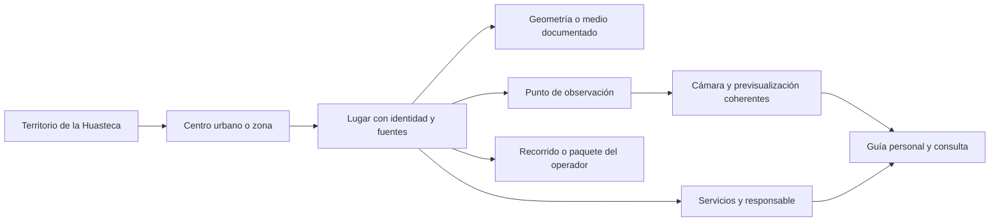

# Del asiento de un estadio a un lugar en la Huasteca

Análisis y decisiones de producto, 26 de octubre de 2026. Referente solicitado por el usuario: [thebuggeddev/football-stadium](https://github.com/thebuggeddev/football-stadium), commit [`1e4387d2f919a1c2be3c0607d2e78e7fc5d90e7f`](https://github.com/thebuggeddev/football-stadium/commit/1e4387d2f919a1c2be3c0607d2e78e7fc5d90e7f).

## Qué se estudió realmente

Se revisaron el árbol completo, README, configuración, licencias y el motor de `index.html`, 4,813 líneas. La demo pública devolvió HTTP 402 por despliegue pausado. Para contrastar el comportamiento se sirvió una copia local intacta de ese commit, con sus iconos y dependencias declaradas. No se instaló otro proyecto ni se incorporó su código al producto.

La revisión técnica está en [análisis del motor](football-stadium-rendering-analysis.md); la observación ejecutada en escritorio y móvil, en [análisis de UX](football-stadium-ux-analysis.md). Ambos distinguen hechos observados, cálculos de la fuente e inferencias. La revisión de lugares y servicios de la Huasteca está en [investigación regional](huasteca-guide-research.md).

## La idea que merece trasladarse

StadiView convierte una unidad identificable del espacio en una perspectiva desde esa unidad. Un asiento tiene identidad, posición, información, una miniatura generada desde su cámara y una transición hasta el punto de observación. Al llegar, cambia el modo de interacción: el usuario mira alrededor y puede regresar a su contexto anterior.

Esta relación es aplicable a turismo: **reconocer el territorio → elegir un lugar → entender su entorno desde un punto de vista → decidir qué hacer**. El objeto central de nuestra plataforma pasa a ser el lugar y sus espacios. Los recorridos y paquetes conectan lugares; la guía también permite descubrir un pueblo, plaza, estancia o servicio por sí mismo.

| Mecanismo comprobado del referente | Razonamiento para nuestro nicho | Aplicación original |
| --- | --- | --- |
| Estadio, sectores, filas y asientos mantienen relaciones y metadatos. | La Huasteca necesita una jerarquía espacial y servicios distintos, no una lista homogénea de cascadas. | Territorio → centro urbano → lugar → punto de observación. Tipos explícitos de pueblo, plaza, hospedaje, cultura, comida, servicios y naturaleza. |
| Seleccionar un asiento actualiza ficha y vuela al punto físico. | La cámara debe expresar qué lugar se eligió y desde dónde se está mirando. | Escena local en metros; selección del lugar, transición cancelable, puntos de llegada/entorno/calle y regreso a vista general. |
| La vista desde el asiento permite girar mirada y variar FOV. | Acercar una cámara al tejado no basta para comprender la escala de una calle o plaza. | Perspectiva a altura humana y exploración del entorno, con teclado y controles táctiles. |
| La miniatura se renderiza desde la propia cámara del asiento. | Ficha, objeto y perspectiva deben coincidir. | Previsualización de la maqueta 3D, identificada como representación y separada de las fotografías reales. |
| Los minimapas mantienen una referencia espacial. | Al entrar a un punto de vista se puede perder la orientación. | Plano urbano con huellas, calles, lugar elegido, posición y dirección actual de mirada. |
| Muchas unidades comparten geometría y metadatos, con picking GPU de un píxel. | La estrategia debe responder a la densidad real de la escena. | Geometría urbana propia para cada huella y lotes de elementos repetidos. Selección sencilla para seis pines locales y un ancla de pueblo; sectorización y picking GPU quedan como opción medida para catálogos masivos. |
| Ficha y acción continúan conectadas al asiento elegido. | Una guía debe ayudar a conocer, guardar y consultar un lugar, además de vender un recorrido. | Guía personal de lugares, enlace compartible, descarga y acceso a fuentes/canales del responsable. |

## Hallazgos que cambian el diseño

**Identidad antes que dibujo.** El motor deriva 33,840 asientos y utiliza arrays de metadatos vinculados a sus índices. Ese índice gráfico no debe convertirse en la identidad comercial de un hotel o habitación. Nuestro registro usa IDs estables; la geometría y el render son representaciones reemplazables del lugar.

**Dos escalas con propósitos distintos.** El atlas regional ubica pueblos y servicios entre la sierra y los parajes. La escena de un centro urbano muestra relaciones entre plaza, calles, patrimonio y alojamiento. Un interior necesita documentación y medios propios. Cargar toda la región con detalle de habitación en una misma escena sería costoso y conceptualmente confuso.

**Un punto de vista tiene procedencia.** En la referencia, la miniatura es una captura del estadio procedural. En nuestro piloto, la miniatura también procede de la maqueta y se etiqueta así. Para afirmar que una habitación tiene cierta vista hacen falta capturas o un modelo medido, identificación de la unidad, orientación y validación del operador. No se inventan interiores ni se convierte una fotografía plana en un panorama real.

**La transición también es navegación.** Se requieren estados de exploración, vuelo y perspectiva humana, salida inequívoca y sustitución de una transición si cambia la selección. Los controles de formulario conservan sus teclas. La preferencia de movimiento reducido debe poder evitar vuelos largos y movimiento decorativo.

**La acción debe describir su resultado.** El checkout de StadiView es simulado. Su contador de carrito no constituye un inventario funcional. Nuestra guía permite guardar lugares y consultar al responsable. No ofrece reservas confirmadas con habitaciones, disponibilidad o tarifas inventadas.

## Qué se conserva como aprendizaje y qué se mejora

Se conserva la relación entre espacio, selección, vista y acción; la legibilidad de la escena; las vistas previas coherentes; el regreso a la orientación anterior y la eficiencia de los elementos repetidos.

Se mejora la adaptación a móvil con una ficha breve y expandible y acciones alcanzables. En la referencia se encontró scroll interno que permite llegar al CTA, pero su descubribilidad y el solapamiento del dock no son una buena base para la guía. Se incorpora liberación de recursos al cambiar de escena, suspensión cuando no se usa, alternativa sin WebGL y separación entre movimiento esencial y ambiental.

La sustitución automática de un asiento ocupado por otro de su fila no se traslada a habitaciones o servicios: las alternativas deben presentarse identificadas para que el visitante elija.

## Primer territorio y verdad geométrica

Se eligió el centro de Xilitla porque permite conectar plaza, patrimonio, museo y alojamientos con fuentes identificadas. La extracción OSM de 400 m produjo 35 huellas y 98 trazas, incluida la plaza y el patio interior del templo. El archivo de aplicación derivado ocupa 22 KB. Las alturas no están documentadas en esas huellas: fachadas, alturas y mobiliario se representan de forma interpretativa y se explican en la interfaz.

El catálogo incorpora 19 lugares documentados, con siete fichas vinculadas a esta escena local: seis pines y Xilitla como ancla de pueblo. Los lugares de otros municipios conservan sus fichas y su contexto regional; no se les asigna una perspectiva ficticia en Xilitla. El modelo permite añadir posteriormente otros centros y espacios capturados de los establecimientos.

La metodología y atribución están en [fuentes del plano urbano](guide-map-sources.md). La ausencia de datos se conserva como ausencia: no se rellena con árboles, niveles, habitaciones o disponibilidad presentados como reales.

## Arquitectura de la adaptación

`guide-data.ts` separa lugares, categorías y fuentes de las mallas. `CityScene` representa el centro y sus puntos de vista. `GuideMiniMap` conserva orientación. `SpatialGuide` coordina selección, directorio, ficha, perspectivas y guía personal. El atlas y el estudio de paquetes existentes se mantienen como otras formas de explorar y trabajar con el territorio.

## Límites y siguiente nivel de contenido

El piloto no reconstruye fachadas exactas ni interiores de hoteles. La siguiente precisión requiere colaboración con los lugares: planos autorizados, medidas, fotografías con permisos, panoramas capturados y puntos de observación identificados. Una plataforma comercial también necesita aislamiento de negocios, edición y verificación de fichas, sincronización, inventario e integraciones de contratación cuando correspondan.

La referencia usa PolyForm Noncommercial y ofrece una licencia comercial separada. El trabajo mantiene una implementación propia de patrones generales de visualización e interacción; no porta su HTML, mallas, interfaz, assets, cálculos de precio ni contenido al producto.

## Aplicación y verificación del avance

La adaptación ya está implementada en la entrada pública: entorno de Xilitla, directorio regional de 19 lugares, seis pines locales, tres puntos de observación por lugar, vuelo, mirada y caminata a 1.7 m, miniatura generada desde la misma cámara y minimapa orientado. La guía personal permite guardar, quitar, compartir y descargar lugares. El estudio de paquetes conserva sus datos y flujos anteriores.

Se añadió una vista despejada para explorar con más espacio, ajustes móviles de 48 px con nombres visibles y un plano seleccionable cuando WebGL no está disponible. La implementación usa Three.js existente, geometría OSM de 22 KB y elementos originales por instancias; no añade motores redundantes, modelos externos ni dependencias. Las previsualizaciones JPEG se generan en memoria y no se acumulan en disco.

Las pruebas y evidencias están en [verificación de la guía espacial](qa-guide-v3.md). Este avance valida la interacción espacial; la precisión arquitectónica y los interiores de cada establecimiento requieren contenido capturado y validado con sus responsables.
